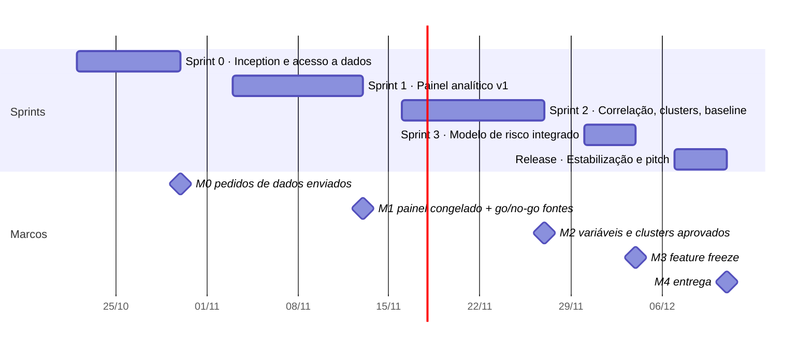
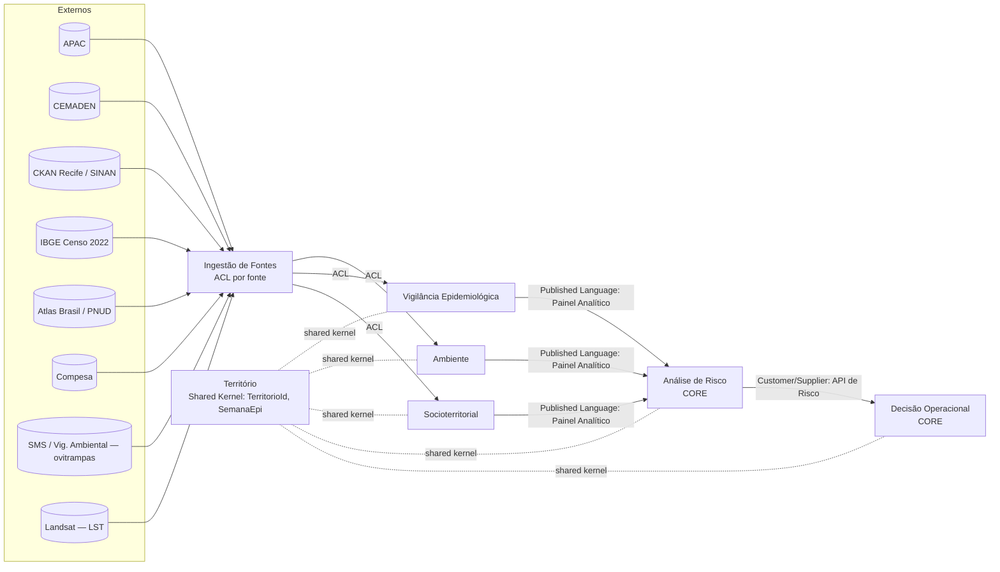
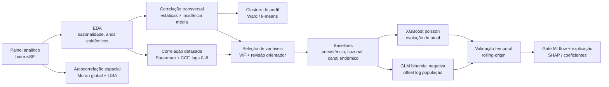

# Plano de ação PULSO (Scrum + DDD)

# PULSO — Plano de ação (Scrum + DDD)

Período: **22/10/2026 → 11/12/2026** (7 semanas, \~32 dias úteis).
Feriados considerados: 02/11 (Finados), 20/11 (Consciência Negra), 08/12 (N. Sra. da Conceição — Recife).

Backlog no Linear: workspace [pulso-si](<https://linear.app/pulso-si>), time **Pulso SI** (`PUL`). Épicos E1–E9 = projetos; histórias = issues `[USnn]`/`[SP-n]` com labels de Squad, Sprint, Tipo, MoSCoW e Contexto; marcos M0–M4 = milestones dos projetos; dependências = relações *blocked by*. Cycles semanais (início segunda): Sprint 0 = Cycle 1; Sprint 1 = Cycles 2–3; Sprint 2 = Cycles 4–5; Sprint 3 = Cycle 6; Release = Cycle 7. Cada issue começa no primeiro cycle da sua sprint.

---

## 1. Ponto de partida (o que já existe no repositório)

| Item | Estado atual | Implicação para o plano |
| -- | -- | -- |
| Casos (SINAN/CKAN) | `dengue_2024.csv`, `dengue_2025.csv`; SE calculada por `DT_NOTIFIC` | Só 2 anos: insuficiente para canal endêmico e correlação defasada robusta. Catálogo tem dados **desde 2016** (`dengue_metadados_..._a_partir_de_2016.json`). |
| Chuva (APAC) | Média **municipal** das estações, soma semanal; APAC já publica estações de redes parceiras, **incluindo CEMADEN** | Dado por estação já existe → dá para espacializar por DS. Integrar CEMADEN direto exige **deduplicar** estações já vindas pela APAC. |
| Temperatura | Open-Meteo | Manter; avaliar INMET A301 como fonte oficial. |
| Território | `bairros_lookup.json` (94 bairros com `ds`, `rpa`, ZEIS), `distritos_sanitarios_*.csv/.geojson` | Base do contexto Território já pronta. |
| Modelo | XGBoost `count:poisson` por bairro, h=1–4, 18 features, gate vs persistência, MLflow + CI | Reaproveitar como pipeline; **não** recomeçar do zero. |
| Pickle do modelo | Referencia `app.services.forecaster` | Mover esse módulo na reorganização DDD **exige retreinar** (ver `backend/README.md`). |
| Ausentes | Ovitrampas, IDH, densidade, intermitência de água, zonas de calor, CEMADEN direto | São o caminho crítico do projeto. |

---

## 2. Visão e meta do produto

**Visão:** apoiar a Vigilância em Saúde do Recife a decidir **em quais Distritos Sanitários (e bairros dentro deles) agir primeiro**, com risco previsto e evidência explicável.

**Meta da entrega (Product Goal, 11/12):**

> Para cada um dos 8 Distritos Sanitários, o PULSO mostra o nível de risco de dengue previsto para 1–4 semanas, os bairros/hotspots que puxam esse risco e os fatores (clima, ovitrampa, território) que mais se correlacionam com ele — validado contra baselines e revisado pelo orientador.

**Critérios de sucesso mensuráveis**

1. Relatório de correlação com lags (0–8 semanas) por DS, aprovado pelo orientador.
2. Clusters/hotspots (LISA) de bairros publicados em mapa.
3. Modelo preditivo que supera persistência **e** canal endêmico em validação temporal (MAE de incidência e recall de "alto risco").
4. Tela por DS integrada à fila de prioridades existente, em produção (Railway).

---

## 3. Metodologia

* **Scrum** com sprints curtas e meta única por sprint; **CRISP-DM** dentro do squad de Inteligência (entendimento → preparação → modelagem → avaliação), cada fase vira itens do backlog.
* **Spikes timeboxed** para aprendizado de ML (máx. 1 dia cada), sempre com saída concreta (notebook + resumo de 1 página).
* **Orientador = Subject Matter Expert de ML**: sessão fixa semanal + participação na Review.
* **Priorização MoSCoW**; histórias dependentes de dado externo são **Must condicional** com data de corte (go/no-go).

### Calendário de sprints



| Sprint | Datas | Dias úteis | Meta |
| -- | -- | -- | -- |
| 0 | 22/10–30/10 | 7 | Linguagem ubíqua, context map, inventário e **pedidos formais de dados**, ambiente, trilha de estudo ML |
| 1 | 03/11–13/11 | 9 | Painel analítico bairro×SE e DS×SE v1 versionado (SINAN 2016+, chuva espacializada, população) + EDA |
| 2 | 16/11–27/11 | 9 | Correlações defasadas, clusters/hotspots e baselines validados com orientador |
| 3 | 30/11–04/12 | 5 | Modelo de risco por DS promovido no MLflow e exposto na API/telas |
| Release | 07/12–11/12 | 4 | Só correções, documentação, model card, ensaio do pitch, deploy congelado |

**Go/no-go em 13/11 (M1):** fonte externa (ovitrampas, intermitência) que não chegou entra só como camada descritiva ou sai do escopo; o modelo segue sem ela. Evita que o caminho crítico externo derrube a entrega.

**Replanejamento (04/11):** os pedidos de dados (US03) já foram feitos — ovitrampas recebidas da SMS; Compesa ainda sem resposta (US13 decide no go/no-go de 13/11). Os demais itens da Sprint 0 não foram concluídos até 30/10 (o Linear levou-os do Cycle 1 para o Cycle 2). O prazo final não muda: esses itens fecham em **06/11** junto com o início da Sprint 1. M0 movido para 06/11.

---

## 4. Times e papéis

10 pessoas (9 devs + 1 designer) → 3 squads alinhados a **bounded contexts** (Team Topologies: cada squad dono de um contexto). Os 2 full-stack — Euclides (PO) e Beatriz (líder de Dados) — ficam em squads diferentes e respondem pelos dois contratos entre contextos.

| Squad | Pessoas | Contextos (DDD) | Responsabilidade |
| -- | -- | -- | -- |
| **Dados** | Beatriz Loyola (líder, full-stack) + Vinicius + Donaire | Ingestão (ACL), Território, Ambiente, Socioterritorial | Coleta, limpeza, georreferenciamento, painel analítico |
| **Inteligência** | Pedro Bedor (líder) + João Rafael + Ariel Cavalcanti | Análise de Risco (core) | Qualidade de dados, EDA, correlação, clusters, alvo, modelo, validação; ponte com orientador |
| **Produto** | Euclides (PO + full-stack, \~40% dev) + Kelwin + Luiza + Celina (designer) | Decisão Operacional (core) + API | Pesquisa e design de UX, telas por DS, explicação, fila/capacidade, deploy, pitch |

Funções por pessoa

| Pessoa | Linear | Função | Histórias |
| -- | -- | -- | -- |
| **Beatriz Loyola** | blgv | Líder técnica de Dados; dona do schema do painel; revisa PRs do squad | US02, US14, US34 |
| **Vinicius** | vsb | Clima e geo | US05, US06, US07, US10, US11 (par com Ariel) |
| **Donaire** | ddc | Vigilância e socioterritorial | US04, US09, US12, US13 |
| **Pedro Bedor** | pvcb | Líder de Inteligência; avaliação e código de produção do modelo; ponto focal do orientador; revisa os notebooks do squad | SP-3, US23, US25, US26, US27 |
| **João Rafael** | jrsga | Analista de dados: qualidade, exploração, correlação e interpretação (notebooks; Pedro/Ariel revisam o que vira script) | SP-1, US15, US16, US17, US18, US19 (conduz), US22, US35 |
| **Ariel Cavalcanti** | aco4 | Espacial, clusters e GLM | SP-2, SP-4, SP-5, US20, US21, US24, apoio US11 |
| **Euclides** | joaomartires2 | PO; define o contrato da API de risco com Pedro; full-stack fora do caminho crítico | US01, US03, US33, US36, US37, US32 (Could) |
| **Luiza** | lcw | Frontend | US38 (S1), US29 (S2–S3), US30 (S3); recebe o handoff da Celina na S1 |
| **Kelwin** | kkls | Backend/API | US28, US31; apoio a US08 na S1 |
| **Celina** | ccaft | Designer: pesquisa, protótipos, visualização de dados, testes de usabilidade, identidade do pitch; trabalha uma sprint à frente da implementação | UX01–UX07 |

Papéis transversais

* **PO:** Euclides — backlog, aceite, contato com Secretaria de Saúde/Compesa/orientador. Como PO e full-stack, pega só histórias fora do caminho crítico.
* **Facilitador (Scrum Master):** rotativo por sprint, **nunca o PO** (evita conflito de papéis). Sugestão: S0–S1 Squad Inteligência, S2–S3 Squad Dados.
* **Dono de contrato:** Beatriz (schema do painel analítico); Euclides (contrato da API de risco, implementado por Kelwin).
* **Scrum of Scrums:** Beatriz, Pedro, Kelwin + PO.
* **Orientador:** Diego (dfb2) — revisa método (alvo, validação, interpretação); não é dono de tarefa. No Linear, é marcado nas histórias que pedem aprovação dele (US01, US19, US22) e acompanha os milestones M2 e M3.
* **Ponte Dados ↔ Inteligência:** João Rafael valida o painel (US15) antes do congelamento de 13/11; Donaire pareia 1 dia/sprint com Inteligência para disseminar conhecimento de ML.
* **Carga da Sprint 3 (1 semana):** Luiza começa US29 na S2 a partir do protótipo UX02 e do mock da US28 entregue por Kelwin; na S3 só pluga o modelo real.
* **Design uma sprint à frente (dual-track):** Celina prototipa e testa na sprint N o que Luiza implementa na N+1; participa do Refinamento e da Review; faz design review dos PRs de tela. Também define o guia de cores/gráficos usado pela Inteligência nos notebooks e relatórios.

### Cerimônias

| Cerimônia | Quando | Duração | Quem |
| -- | -- | -- | -- |
| Daily por squad | Todo dia útil (assíncrona permitida) | 15 min | Squad |
| Scrum of Scrums | Ter e Qui | 15 min | 1 por squad + PO |
| Sessão com orientador | 1×/semana | 60 min | Inteligência + PO |
| Planning | 1º dia da sprint | 2 h | Todos |
| Refinamento | Meio da sprint | 1 h | PO + 1 por squad |
| Review | Último dia | 1 h | Todos + orientador |
| Retro | Último dia | 45 min | Todos |

---

## 5. Modelagem DDD

### 5.1 Subdomínios

| Subdomínio | Tipo | Por quê |
| -- | -- | -- |
| Análise de Risco | **Core** | Diferencial: correlação, clusters e previsão por DS |
| Decisão Operacional | **Core** | Transforma risco em prioridade sob capacidade limitada |
| Vigilância Epidemiológica | Suporte | Casos e ovitrampas como sinais |
| Ambiente (clima + calor) | Suporte | Chuva, temperatura, ilhas de calor |
| Socioterritorial | Suporte | Densidade, IDH, intermitência de água |
| Território | Genérico/Suporte | Bairro, DS, RPA, setor censitário, geometrias |
| Ingestão de Fontes | Genérico | Adaptadores de APAC, CEMADEN, CKAN, IBGE, Atlas, Compesa |

### 5.2 Context map



* **ACL (Anti-Corruption Layer):** cada fonte externa tem um adaptador que traduz o formato dela para o modelo interno (ex.: `-` da APAC → leitura ausente; nome de bairro do SINAN → `TerritorioId`). Nenhum formato externo vaza para Análise de Risco.
* **Shared Kernel:** `TerritorioId` (bairro/DS), `SemanaEpidemiologica`, `Horizonte` — mudanças exigem acordo dos 3 squads.
* **Published Language:** o **Painel Analítico** (parquet versionado + data card) é o contrato entre Dados e Inteligência.
* **Customer/Supplier:** Decisão (cliente) define o que precisa da API de Risco; Inteligência (fornecedor) entrega.

### 5.3 Linguagem ubíqua (glossário mínimo)

| Termo | Definição no PULSO |
| -- | -- |
| Semana Epidemiológica (SE) | Semana CDC (domingo–sábado), id `YYYY-Wnn` |
| Distrito Sanitário (DS) | Uma das 8 divisões de gestão de saúde do Recife (DS I–VIII); unidade de decisão |
| Bairro | Uma das 94 unidades territoriais; unidade de modelagem |
| Caso notificado | Registro SINAN de dengue; SE por data de início de sintomas quando disponível (`DT_SIN_PRI`), senão `DT_NOTIFIC` — **decisão a validar na S0** |
| Incidência | Casos / população × 100 mil |
| Canal endêmico | Faixa esperada de casos por SE a partir de anos anteriores (não epidêmicos) |
| Alto risco | Incidência prevista acima do limite superior do canal endêmico do território |
| IPO / IDO | Índice de Positividade de Ovitrampas / Índice de Densidade de Ovos |
| Intermitência | Dias por semana sem abastecimento de água no bairro |
| Ilha de calor | Anomalia de temperatura de superfície (LST) do bairro vs. média da cidade |
| Hotspot | Bairro classificado como Alto-Alto no LISA (Moran local) |
| Perfil territorial | Cluster de bairros com perfil socioambiental semelhante |
| Horizonte | Semanas à frente da previsão (1–4) |
| Nível de risco | Crítico / Alto / Moderado / Baixo (já usado no produto) |

### 5.4 Agregados, value objects e eventos

| Contexto | Agregado (raiz) | Value objects | Eventos de domínio |
| -- | -- | -- | -- |
| Território | `DistritoSanitario` (contém bairros) | `TerritorioId`, `Geometria`, `Populacao` | — |
| Ambiente | `SerieClimatica` (por estação) | `Precipitacao`, `Temperatura`, `Estacao`, `OrigemDado` | `MedicoesColetadas` |
| Vigilância | `SerieCasos`, `CicloOvitrampa` | `SemanaEpidemiologica`, `IPO`, `IDO` | `NotificacoesAtualizadas` |
| Socioterritorial | `PerfilSocioterritorial` (por bairro) | `IDH`, `Densidade`, `Intermitencia`, `AnomaliaLST` | — |
| Análise de Risco | `PainelAnalitico`, `ExperimentoModelo`, `PrevisaoRisco` | `NivelRisco`, `Contribuicao`, `Horizonte` | `PainelConsolidado`, `ModeloPromovido`, `PrevisaoGerada`, `HotspotIdentificado` |
| Decisão | `FilaPrioridade`, `DecisaoOperacional` | `Capacidade`, `Recomendacao` | `DecisaoRegistrada` |

### 5.5 Organização do código (incremental)

```
backend/app/
  shared/            # TerritorioId, SemanaEpidemiologica, Horizonte
  territorio/
  ingestao/          # um adaptador por fonte (apac, cemaden, sinan, ibge, atlas, compesa, ovitrampas, lst)
  ambiente/  vigilancia/  socioterritorial/
  risco/             # painel, correlacao, clusters, modelo, explicacao
  decisao/
  api/               # blueprints Flask
```

Regra: **código novo** nasce na pasta do contexto; código existente só migra quando for tocado. `app.services.forecaster` só muda de lugar junto com um retreino (o pickle referencia o caminho).

---

## 6. Estratégia analítica (para validar com o orientador)

### 6.1 Decisões de desenho

1. **Modelar por bairro × SE, decidir por DS.** Com só 8 DS, correlação de variáveis estáticas por DS tem n=8 — sem poder estatístico. Bairro (n=94) dá amostra; o resultado é agregado por DS.
2. **Separar variáveis dinâmicas e estáticas.**
   * Dinâmicas (semanais): chuva, temperatura, ovitrampas, casos → correlação **defasada no tempo**.
   * Estáticas (anuais/censitárias): IDH, densidade, intermitência, ilha de calor → correlação **transversal** e **clusters**.
3. **Histórico 2016–2025** para casos e chuva: necessário para canal endêmico e para capturar anos epidêmicos e não epidêmicos.
4. **Chuva espacializada:** estações APAC + CEMADEN (deduplicadas) → chuva por DS (Voronoi ou IDW). Hoje o modelo usa média municipal.
5. **Sem vazamento:** toda feature da SE *t* usa só dados ≤ *t*; considerar atraso de notificação do SINAN.

### 6.2 Pipeline



### 6.3 Métodos e porquê

| Pergunta | Método | Saída | Biblioteca |
| -- | -- | -- | -- |
| Chuva/temperatura/ovitrampa antecipam casos? Com qual atraso? | Spearman e correlação cruzada (CCF) por lag, após remover sazonalidade; p-valor corrigido (Benjamini-Hochberg) | Heatmap variável × lag × DS | `pandas`, `scipy`, `statsmodels` |
| Quais fatores territoriais se associam à incidência? | Spearman bairro (n=94); VIF para colinearidade | Ranking de variáveis | `scipy`, `statsmodels` |
| Onde estão as zonas de alto risco agrupadas? | Moran global + **LISA** (permutação) | Mapa de hotspots HH/LL/HL/LH | `libpysal`, `esda`, `geopandas` |
| Que tipos de território existem? | Clusterização hierárquica (Ward) ou k-means em variáveis padronizadas; k por silhouette + interpretabilidade; estabilidade por bootstrap; Kruskal-Wallis da incidência entre clusters | Perfis territoriais | `scikit-learn` |
| O que é "alto risco"? | Canal endêmico (mediana/quartis ou média ± 1,96 DP de 5–7 anos não epidêmicos) | Rótulo alvo | `pandas` |
| Prever risco 1–4 semanas | Baselines → GLM binomial negativa (interpretável) → XGBoost | Incidência prevista + nível | `statsmodels`, `xgboost` |
| O modelo funciona? | Rolling-origin por temporada; MAE de incidência, **recall** e precisão de alto risco, precisão@k, calibração | Métricas no MLflow + gate | `mlflow` |

Hipóteses de defasagem (chuva → ovos → casos em semanas) devem ser **testadas**, não assumidas. Correlação não implica causa; resultados por bairro/DS são ecológicos (não valem para indivíduos).

### 6.4 Trilha de estudo de ML (spikes da Sprint 0–1)

| Spike | Tema | Entregável |
| -- | -- | -- |
| SP-1 | Séries temporais: sazonalidade, autocorrelação, CCF | Notebook com CCF chuva × casos (dados atuais) |
| SP-2 | Modelos de contagem: Poisson vs binomial negativa, offset | GLM rodando no painel 2024–25 |
| SP-3 | Validação temporal e vazamento | Esquema de rolling-origin documentado |
| SP-4 | Estatística espacial: Moran/LISA | Mapa LISA de incidência 2024 |
| SP-5 | Clusterização e escolha de k | Notebook com silhouette + dendrograma |

Cada spike: 1 dia, apresentado em 15 min na sessão com o orientador.

---

## 7. Fontes de dados

| Fonte | Variável | Granularidade | Acesso | Risco | Squad |
| -- | -- | -- | -- | -- | -- |
| CKAN Recife (SINAN) | Casos de dengue | Registro → bairro×SE | Download aberto; já integrado (2024–25) | Baixo — estender a 2016+ | Dados |
| APAC | Chuva diária | Estação | Formulário oficial; já integrado | Baixo | Dados |
| CEMADEN | Chuva (pluviômetros automáticos) | Estação, sub-horária | Formulário de download por UF/município/mês ([mapainterativo.cemaden.gov.br](<https://mapainterativo.cemaden.gov.br/download/download_form.php?type=5>)); exige e-mail | Médio — deduplicar com APAC | Dados |
| Open-Meteo / INMET | Temperatura | Ponto/estação | Aberto; já integrado | Baixo | Dados |
| IBGE Censo 2022 | População, densidade | Setor censitário → bairro | Aberto | Baixo | Dados |
| Atlas Brasil (PNUD) | IDH | UDH/bairro, **2010** | Aberto | Médio — dado defasado | Dados |
| Compesa | Intermitência de água | Bairro (calendário de abastecimento) | **Pedido formal / LAI** | **Alto** | PO + Dados |
| SMS Recife / Vigilância Ambiental | Ovitrampas (IPO, IDO) | Armadilha/bairro × ciclo | **Pedido formal / LAI** (não confirmado em dados abertos) | **Alto** | PO + Dados |
| Landsat 8/9 | Temperatura de superfície (ilhas de calor) | Raster 30 m → bairro | Aberto (USGS / Google Earth Engine) | Médio — processamento | Dados + Inteligência |
| ESIG / CKAN | Bairros, DS, ZEIS | Polígono | Já no repositório | Baixo | — |

**Ação do dia 1 (PO):** enviar ofícios/pedidos LAI para Secretaria de Saúde (ovitrampas, com histórico por bairro/ciclo) e Compesa (calendário de abastecimento por bairro). Envolver o orientador/faculdade no ofício aumenta a chance de resposta.

---

## 8. Backlog — épicos e histórias de usuário

Personas

* **Gestora da Vigilância** (Secretaria de Saúde): distribui equipes entre DS.
* **Coordenador de DS:** decide bairros e ações dentro do distrito.
* **Epidemiologista/Analista:** valida evidências e métodos.
* **Cientista de dados do time** (persona interna).

Estimativa em story points (Fibonacci). Prioridade MoSCoW: **M** Must, **M\*** Must condicional (go/no-go 13/11), **S** Should, **C** Could.

### E1 — Fundação e linguagem ubíqua (Sprint 0)

**US01 — Glossário e context map** · M · 2 pts · PO
Como membro do time, quero um glossário e um context map acordados, para que dados, ML e produto usem os mesmos termos.

- [ ] Glossário (seção 5.3) revisado pelos 3 squads e pelo orientador.
- [ ] Decisão registrada: SE por `DT_SIN_PRI` ou `DT_NOTIFIC`.
- [ ] Context map publicado em `docs/`.

**US02 — Território canônico** · M · 3 pts · Dados
Como cientista de dados, quero uma tabela única bairro → DS → RPA → setores censitários com ids estáveis, para agregar qualquer fonte ao DS sem ambiguidade.

- [ ] 94 bairros mapeados para 8 DS, conferidos com `distritos_sanitarios_*.csv`.
- [ ] Normalização de nomes (acentos, grafias do SINAN) com teste que falha se algum bairro ficar sem DS.
- [ ] `TerritorioId` e `SemanaEpidemiologica` no shared kernel.

**US03 — Pedidos formais de dados** · M · 1 pt · PO
Como PO, quero pedidos enviados à SMS e à Compesa até 30/10, para que as fontes externas cheguem antes do go/no-go.

- [ ] Ofícios/LAI protocolados com número de protocolo registrado.
- [ ] Formato e período desejados especificados (bairro × semana, 2016+).

### E2 — Ingestão de fontes (ACL)

**US04 — Histórico SINAN 2016–2025** · M · 5 pts · Dados · S1
Como epidemiologista, quero casos de dengue por bairro × SE desde 2016, para calcular canal endêmico e ter amostra suficiente para correlação.

- [ ] Série bairro × SE 2016–2025 gerada por script reprodutível.
- [ ] % de registros sem bairro/geocodificação reportado por ano.
- [ ] Anos epidêmicos identificados.

**US05 — Chuva por estação e por DS (APAC)** · M · 5 pts · Dados · S1
Como analista, quero a chuva por estação e agregada por DS, para substituir a média municipal.

- [ ] Inventário de estações (código, nome, lat/lon, rede de origem, período).
- [ ] Atribuição estação → DS documentada (Voronoi ou IDW) e testada.
- [ ] Semana com falha acima do limite marcada como incompleta, não preenchida silenciosamente.

**US06 — Integração CEMADEN** · M · 5 pts · Dados · S1
Como analista, quero os pluviômetros CEMADEN de Recife integrados, para aumentar a densidade de estações.

- [ ] Adaptador próprio (ACL) lendo o download oficial.
- [ ] Deduplicação contra estações CEMADEN já publicadas pela APAC.
- [ ] Flag de origem (`APAC`/`CEMADEN`) em cada medição.

**US07 — Reconciliação APAC × CEMADEN** · S · 3 pts · Dados · S2
Como analista, quero uma regra de precedência e comparação entre fontes, para confiar na série de chuva.

- [ ] Correlação entre pares de estações próximas reportada.
- [ ] Regra de preenchimento de lacunas documentada.

**US08 — População e densidade (Censo 2022)** · M · 3 pts · Dados · S1
Como epidemiologista, quero população e densidade por bairro e DS, para calcular incidência.

- [ ] Agregação setor censitário → bairro → DS; soma confere com total municipal.

**US09 — IDH** · S · 3 pts · Dados · S1
Como analista, quero o IDH por bairro, para testar associação com incidência.

- [ ] UDH/bairro do Atlas mapeado; defasagem (2010) explícita no data card.

**US10 — Temperatura histórica 2016+** · M · 2 pts · Dados · S1

- [ ] Série semanal média/máxima 2016–2025; fonte registrada.

**US11 — Zonas de calor (LST)** · S · 5 pts · Dados + Inteligência · S2
Como coordenador de DS, quero saber quais bairros são ilhas de calor, para considerar isso no risco.

- [ ] LST média por bairro em estação seca e chuvosa (Landsat, nuvens filtradas).
- [ ] Anomalia vs média da cidade; mapa gerado.

**US12 — Ovitrampas** · M\* · 5 pts · Dados · S1–S2
Como epidemiologista, quero IPO e IDO por bairro × ciclo, para medir a pressão vetorial antes dos casos.

- [ ] Adaptador para o formato recebido da SMS.
- [ ] Cobertura (armadilhas ativas por DS e período) reportada.
- [ ] Se não chegar até 13/11: história sai do modelo e vira item de roadmap.

**US13 — Intermitência de água** · M\* · 5 pts · Dados · S2
Como gestora, quero saber quantos dias por semana cada bairro fica sem água, para testar a relação armazenamento de água × criadouros.

- [ ] Métrica dias/semana sem abastecimento por bairro.
- [ ] Mesma regra de go/no-go da US12.

### E3 — Painel analítico (Published Language)

**US14 — Painel analítico versionado** · M · 8 pts · Dados (FS-D) · S1
Como cientista de dados, quero um painel bairro × SE e DS × SE com todas as variáveis, versionado, para que toda análise seja reprodutível.

- [ ] Um comando regenera o painel a partir das fontes.
- [ ] Schema validado por teste (tipos, chaves únicas, faixas válidas).
- [ ] Data card: fonte, data de coleta, cobertura, versão.
- [ ] Teste garantindo que nenhuma feature de *t* usa dado > *t*.

**US15 — Relatório de qualidade de dados** · S · 3 pts · Inteligência (João Rafael) · S1

- [ ] Faltantes e outliers por fonte × DS × ano.

### E4 — Correlação (Análise de Risco)

**US16 — EDA por DS** · M · 3 pts · Inteligência · S1
Como epidemiologista, quero ver sazonalidade e anos epidêmicos por DS, para entender o comportamento antes de modelar.

- [ ] Séries por DS, decomposição sazonal, comparação entre anos.

**US17 — Correlação defasada** · M · 5 pts · Inteligência · S2
Como gestora, quero saber com quantas semanas de antecedência chuva, temperatura e ovitrampas sinalizam aumento de casos, para agir antes do pico.

- [ ] Spearman/CCF para lags 0–8 por variável e DS, após remoção de sazonalidade.
- [ ] p-valores corrigidos (Benjamini-Hochberg).
- [ ] Heatmap variável × lag × DS.

**US18 — Correlação transversal de fatores territoriais** · M · 3 pts · Inteligência · S2

- [ ] Spearman bairro (n=94) entre IDH, densidade, intermitência, LST, ZEIS e incidência média.
- [ ] VIF calculado; variáveis colineares sinalizadas.

**US19 — Seleção de variáveis aprovada** · M · 2 pts · Inteligência + orientador · S2 (M2)

- [ ] Lista de variáveis que entram/saem do modelo, com justificativa, aprovada pelo orientador.

### E5 — Clusters e hotspots

**US20 — Hotspots (LISA)** · M · 5 pts · Inteligência · S2
Como coordenador de DS, quero ver quais bairros formam aglomerados de alto risco, para concentrar ações de campo.

- [ ] Moran global por temporada; LISA com 999 permutações.
- [ ] Mapa HH/LL/HL/LH por temporada exportado em GeoJSON.

**US21 — Perfis territoriais (clusters)** · S · 5 pts · Inteligência · S2
Como gestora, quero agrupar bairros com perfil socioambiental parecido, para planejar estratégias por tipo de território.

- [ ] k escolhido por silhouette + interpretação; estabilidade por bootstrap.
- [ ] Diferença de incidência entre clusters testada (Kruskal-Wallis).
- [ ] Cada cluster com nome em linguagem de domínio (ex.: "denso, baixa renda, intermitente").

### E6 — Modelo preditivo de risco

**US22 — Definição de alto risco (canal endêmico)** · M · 3 pts · Inteligência + orientador · S1
Como gestora, quero que "alto risco" siga o canal endêmico, para que o alerta use um critério já reconhecido pela vigilância.

- [ ] Método e anos de referência documentados e aprovados.
- [ ] Rótulo gerado no painel por bairro e DS.

**US23 — Baselines** · M · 3 pts · Inteligência · S2

- [ ] Persistência, sazonal ingênuo e canal endêmico avaliados com o mesmo esquema de validação.

**US24 — GLM binomial negativa** · M · 5 pts · Inteligência · S2–S3
Como epidemiologista, quero um modelo interpretável, para entender o efeito de cada fator.

- [ ] Offset log(população); coeficientes com IC; run no MLflow.

**US25 — XGBoost com novas variáveis** · S · 5 pts · Inteligência · S3

- [ ] Evolução do `PulsoForecaster` com as variáveis aprovadas; comparação com GLM no MLflow.

**US26 — Validação temporal e gate** · M · 5 pts · Inteligência · S2–S3
Como PO, quero que só modelos que superam os baselines sejam promovidos, para não exibir previsão pior que o óbvio.

- [ ] Rolling-origin por temporada.
- [ ] `export_model.py` passa a exigir também recall de alto risco ≥ baseline.
- [ ] CI (`ml.yml`) roda o novo gate.

**US27 — Explicação por DS** · M · 3 pts · Inteligência · S3

- [ ] Top fatores por DS/bairro (SHAP ou coeficientes) traduzidos para termos do glossário.

### E7 — Decisão operacional (Produto)

**US28 — API de risco por DS** · M · 5 pts · Produto (P2; contrato: Euclides) · S2–S3
Como frontend, quero um endpoint de risco por DS, para montar a visão distrital.

- [ ] `GET /risco/distritos?semana_id=&horizonte=` com nível, incidência prevista, bairros-chave, fatores e cobertura de dados.
- [ ] Contrato acordado com Inteligência na S2 (mock até o modelo chegar); teste de contrato.

**US29 — Visão por Distrito Sanitário** · M · 8 pts · Produto · S2–S3 (começa contra o mock da US28)
Como gestora, quero ver os 8 DS com nível de risco previsto para 1–4 semanas, para distribuir equipes entre distritos.

- [ ] Mapa de DS com nível de risco e seletor de horizonte.
- [ ] Ranking de DS integrado à fila de prioridades existente.

**US38 — Camada dos Distritos Sanitários no mapa** · M · 3 pts · Produto (Luiza) · S1
Como gestora, quero ver os 8 Distritos Sanitários desenhados no mapa, para me orientar por DS antes mesmo do modelo de risco por DS existir.

- [ ] 8 polígonos de `distritos_sanitarios_8d43533d.geojson` servidos pela API e exibidos no `MapaRecife.jsx`; alternância bairros ↔ DS.
- [ ] Cor provisória pelo risco agregado dos bairros do DS (ranking atual) até a US28.

**US30 — Drill-down DS → bairros** · S · 5 pts · Produto · S3
Como coordenador de DS, quero abrir um DS e ver bairros, hotspots e perfil, para escolher onde agir.

- [ ] Bairros do DS com nível, hotspot LISA e cluster.

**US31 — Confiabilidade e explicação na tela** · M · 5 pts · Produto · S3
Como gestora, quero ver por que um DS está em alto risco e quão confiável é o dado, para justificar a decisão.

- [ ] Fatores principais; aviso de defasagem do SINAN e fontes ausentes.

**US32 — Tela de evidências** · C · 5 pts · Produto · S3
Como banca/gestora, quero ver heatmap de correlações e clusters, para entender a base da recomendação.

**US33 — Capacidade por DS** · S · 5 pts · Produto · S3

- [ ] `PulsoContext` passa a distribuir capacidade entre DS (hoje é por bairro).

**Design (UX) — Celina**

| Id | História | MoSCoW | Pts | Sprint | Desbloqueia |
| -- | -- | -- | -- | -- | -- |
| UX01 | Personas e jornada de decisão (gestora, coordenador de DS) | M | 2 | S0 | US01 (relacionada) |
| UX02 | Protótipo da visão por DS (mapa, horizonte, ranking, estados vazios/erro; substitui os PLACEHOLDER de `figma/`) | M | 5 | S1 | US29 |
| UX03 | Protótipo do drill-down DS → bairros (hotspot, cluster) | S | 3 | S1–S2 | US30 |
| UX04 | Design da explicação e da confiabilidade (fatores, incerteza, defasagem do SINAN) | M | 3 | S2 | US31 |
| UX05 | Visualização das evidências (heatmap lag × DS, mapa de hotspots/clusters) + guia de gráficos | C | 3 | S2 | US32 |
| UX06 | Teste de usabilidade do protótipo com 3–5 usuários | M | 3 | S2 | US29, US30, US31 |
| UX07 | Identidade visual do pitch e roteiro visual da demo | M | 3 | Release | US37 (relacionada) |

### E8 — Qualidade e governança

**US34 — CI de dados + modelo** · M · 3 pts · FS-D · S1–S2

- [ ] Workflow regenera painel (amostra), treina, aplica gate e roda testes.

**US35 — Data cards e model card** · M · 2 pts · Inteligência · Release

- [ ] Limitações explícitas: ecológico, subnotificação, IDH 2010, chuva interpolada.

### E9 — Entrega

**US36 — Deploy congelado** · M · 2 pts · Produto · Release

- [ ] Railway com modelo e painel da versão final; `/health` com `run_id`.

**US37 — Pitch e demo** · M · 3 pts · PO · Release

- [ ] Roteiro + 2 ensaios cronometrados; demo com plano B offline.

### Distribuição por sprint

| Sprint | Dados | Inteligência | Produto |
| -- | -- | -- | -- |
| 0 | US02 | SP-1, SP-2, SP-3 | US01, US03, UX01 |
| 1 | US04, US05, US06, US08, US09, US10, US12, US14, US34 | US15, US16, US22, SP-4, SP-5 | Mock da API (US28), US38, UX02, UX03 |
| 2 | US07, US11, US12/US13 (se dado chegou) | US17, US18, US19, US20, US21, US23, US24, US26 | US28, US29 (contra o mock), UX04, UX05, UX06 |
| 3 | Suporte / correções | US25, US26, US27 | US29 (modelo real), US30, US31, US33, US32 (se sobrar) |
| Release | — | US35 | US36, US37, UX07 |

Squads com folga numa sprint puxam itens de outra (ex.: Produto ajuda Dados no Censo na S1) — o backlog é único.

---

## 9. Definition of Ready / Done

**Ready**

* História no formato persona/ação/benefício com critérios de aceite verificáveis.
* Fonte de dados acessível ou spike prévio concluído.
* Dependências entre squads identificadas no Scrum of Scrums.
* Estimada pelo squad dono.
* História de tela: protótipo aprovado no Figma (história UX correspondente concluída).

**Done — código**

* PR revisado por alguém de **outro** squad; CI verde (`ml.yml`, `npm run lint`).
* Teste cobrindo o comportamento novo; README/docs atualizados.
* História de tela: design review da Celina (fidelidade ao protótipo, estados vazio/erro, acessibilidade de contraste).

**Done — design**

* Protótipo navegável no Figma com specs e componentes; validado com o PO; handoff feito com quem implementa.

**Done — dados**

* Script reprodutível; data card atualizado; teste de schema; cobertura reportada.

**Done — ML**

* Run no MLflow com parâmetros e métricas; comparado com baselines na mesma validação temporal; revisado pelo orientador quando mudar alvo, validação ou variáveis.

---

## 10. Riscos

| Risco | Prob. | Impacto | Mitigação |
| -- | -- | -- | -- |
| Ovitrampas/intermitência não chegam a tempo | Alta | Alto | Pedido no dia 1; go/no-go 13/11; modelo não depende delas |
| Baixa experiência em ML leva a conclusões erradas | Média | Alto | Spikes guiados; GLM interpretável antes de XGBoost; orientador aprova alvo, validação e variáveis |
| Poucos DS (n=8) para inferência | Certa | Médio | Modelar por bairro, reportar por DS |
| Vazamento temporal infla métricas | Média | Alto | Teste automático no painel; rolling-origin |
| Atraso/subnotificação do SINAN | Alta | Médio | Usar só SE consolidadas; avisar na tela (já existe para cobertura) |
| Estações duplicadas APAC/CEMADEN | Média | Médio | Deduplicação por código/coordenada (US06) |
| Mover `forecaster` quebra o pickle | Média | Médio | Só mover junto com retreino via CI |
| Feriados e fim de semestre reduzem capacidade | Alta | Médio | Sprints já descontam feriados; feature freeze 04/12 |
| PO sobrecarregado (PO + dev) | Média | Médio | PO com \~40% de dev; facilitação com outra pessoa |

---

## 11. Primeiras 48 horas

1. **PO:** protocolar pedidos à SMS (ovitrampas) e Compesa (abastecimento); agendar sessão semanal fixa com o orientador.
2. **Todos:** kickoff de 1 h — visão, squads, glossário (US01), context map.
3. **Dados:** baixar CSVs SINAN 2016–2023 do CKAN e o inventário de estações APAC/CEMADEN de Recife.
4. **Inteligência:** SP-1 (CCF chuva × casos com o painel 2024–25 que já existe).
5. **Produto:** board do Linear (já criado, com Cycles) — refinar histórias da S0 e S1.